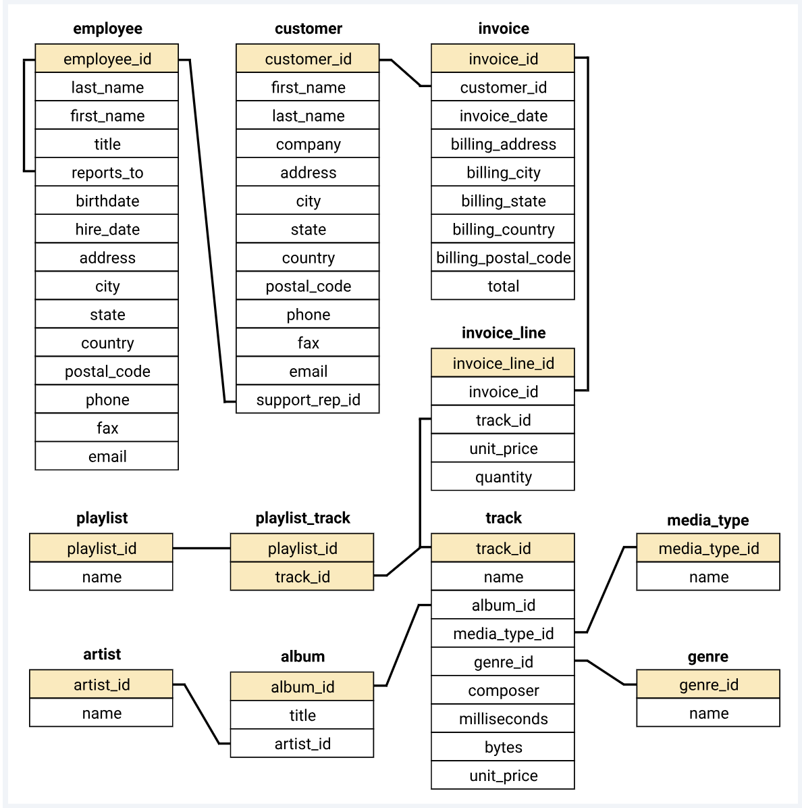

<<<<<<< HEAD
# Music Store SQL Analysis

A SQL portfolio project built on a music store database (the Chinook sample
schema). It covers schema design, data loading, and 11 business questions that
move from simple aggregation to window functions and CTEs.

The project uses **PostgreSQL**.

---

## Dataset

The database models a digital music store: a catalog of artists, albums, tracks
and genres, plus customers, employees, invoices and playlists.

| Table            | Rows | Grain                                            |
| ---------------- | ---: | ------------------------------------------------ |
| `artist`         |  275 | One row per artist                               |
| `album`          |  347 | One row per album                                |
| `genre`          |   25 | One row per music genre                          |
| `media_type`     |    5 | One row per media format                         |
| `track`          | 3503 | One row per track                                |
| `playlist`       |   18 | One row per playlist                             |
| `playlist_track` | 8715 | One row per track-in-playlist (many-to-many)     |
| `employee`       |    9 | One row per employee                             |
| `customer`       |   59 | One row per customer                             |
| `invoice`        |  614 | One row per invoice (one purchase)               |
| `invoice_line`   | 4757 | One row per track on an invoice                  |

The raw files are UTF-8 CSVs. `employee.birthdate` and `employee.hire_date` use
`DD-MM-YYYY` formatting; every other date is ISO `YYYY-MM-DD`.

---

## Project structure

```
Music-Playlist-SQL-Project/
├── README.md
├── data/
│   ├── raw/
│   │   ├── Music_Store_database.sql        # original dump (kept for reference)
│   │   ├── Music_Store_Query.sql           # original analysis file (superseded)
│   │   ├── Music Store- Create Tables Query.txt  # first draft DDL (superseded)
│   │   └── *.csv                           # 11 source tables
│   └── processed/                          # cleaned / exported results
├── sql/
│   ├── 01_create_tables.sql                # runnable schema: keys, FKs, indexes
│   └── 02_analysis_queries.sql             # the 11 analysis questions
└── docs/
    └── schema_diagram.png
```

`data/raw/Music_Store_database.sql` is the original dump and is **not** meant to
be executed as-is: it mixes `CREATE DATABASE` with the table definitions, uses
`billing_postal` where the CSV says `billing_postal_code`, and has no foreign
keys. `sql/01_create_tables.sql` is the cleaned, runnable version.

`data/raw/Music_Store_Query.sql` is the original analysis file; the corrected,
documented replacement is `sql/02_analysis_queries.sql`.

---

## Schema



Key relationships:

- `artist` 1─* `album` 1─* `track`
- `genre` 1─* `track`, `media_type` 1─* `track`
- `playlist` *─* `track` through `playlist_track`
- `employee` 1─* `customer` (via `support_rep_id`); `employee.reports_to` is a
  self-reference to the manager
- `customer` 1─* `invoice` 1─* `invoice_line` *─1 `track`

`employee.levels` (L1–L7) stores the seniority band. The ERD omits it, but the
seniority question depends on it, so it is kept in the schema.

---

## Getting started

### 1. Requirements

- PostgreSQL 12 or newer
- `psql` on your `PATH` (or use the full path to the binaries)

### 2. Create the database and schema

```bash
createdb -U postgres music_store
psql -U postgres -d music_store -f sql/01_create_tables.sql
```

The schema script drops and recreates the tables, so it is safe to re-run while
developing. Do not run it against a database whose data you want to keep.

### 3. Load the CSVs

Run this from the project root so the relative paths resolve. Save it as
`load_data.sql` (or paste it into `psql`) and execute it:

```sql
\set ON_ERROR_STOP on
SET client_encoding = 'UTF8';
SET datestyle = 'DMY';          -- employee dates are DD-MM-YYYY

BEGIN;
\copy artist         (artist_id, name) FROM 'data/raw/artist.csv' WITH (FORMAT csv, HEADER true);
\copy album          (album_id, title, artist_id) FROM 'data/raw/album.csv' WITH (FORMAT csv, HEADER true);
\copy genre          (genre_id, name) FROM 'data/raw/genre.csv' WITH (FORMAT csv, HEADER true);
\copy media_type     (media_type_id, name) FROM 'data/raw/media_type.csv' WITH (FORMAT csv, HEADER true);
\copy track          (track_id, name, album_id, media_type_id, genre_id, composer, milliseconds, bytes, unit_price) FROM 'data/raw/track.csv' WITH (FORMAT csv, HEADER true);
\copy playlist       (playlist_id, name) FROM 'data/raw/playlist.csv' WITH (FORMAT csv, HEADER true);
\copy playlist_track (playlist_id, track_id) FROM 'data/raw/playlist_track.csv' WITH (FORMAT csv, HEADER true);
\copy employee       (employee_id, last_name, first_name, title, reports_to, levels, birthdate, hire_date, address, city, state, country, postal_code, phone, fax, email) FROM 'data/raw/employee.csv' WITH (FORMAT csv, HEADER true);
\copy customer       (customer_id, first_name, last_name, company, address, city, state, country, postal_code, phone, fax, email, support_rep_id) FROM 'data/raw/customer.csv' WITH (FORMAT csv, HEADER true);
\copy invoice        (invoice_id, customer_id, invoice_date, billing_address, billing_city, billing_state, billing_country, billing_postal_code, total) FROM 'data/raw/invoice.csv' WITH (FORMAT csv, HEADER true);
\copy invoice_line   (invoice_line_id, invoice_id, track_id, unit_price, quantity) FROM 'data/raw/invoice_line.csv' WITH (FORMAT csv, HEADER true);
COMMIT;
```

The `BEGIN`/`COMMIT` wrapper matters: `employee.reports_to` is a deferred foreign
key because the first employee row reports to an employee that appears later in
the file.

### 4. Run the analysis

```bash
psql -U postgres -d music_store -f sql/02_analysis_queries.sql
```

---

## Analysis questions

### Easy

| # | Question | Concepts |
| - | -------- | -------- |
| 1 | Who is the most senior employee by job title? | `ORDER BY`, `LIMIT` |
| 2 | Which countries have the most invoices? | `GROUP BY`, `COUNT` |
| 3 | What are the top 3 invoice totals? | `ORDER BY`, `LIMIT` |
| 4 | Which city has the best customers (highest invoice total)? | `SUM`, `GROUP BY` |
| 5 | Who is the best customer by total spend? | `JOIN`, `SUM`, `GROUP BY` |

### Moderate

| # | Question | Concepts |
| - | -------- | -------- |
| 1 | Who listens to Rock? (email, name, genre) | multi-table `JOIN`, `DISTINCT`, `EXISTS` |
| 2 | Which artists wrote the most Rock music? (top 10) | multi-table `JOIN`, `COUNT` |
| 3 | Which tracks are longer than the average track? | scalar subquery, `AVG` |

### Advanced

| # | Question | Concepts |
| - | -------- | -------- |
| 1 | How much did each customer spend on the best-selling artist? | CTE, revenue calculation |
| 2 | What is the most popular genre per country? | CTE + `RANK()` / max-per-group join |
| 3 | Which customer spent the most per country? | CTE + `RANK()` / max-per-group join |

Questions 2 and 3 of the advanced set have two solutions each: a window-function
version and a join-to-max version. Both return **all** rows that tie for first
place, which is what the questions ask for.

---

## Notes and corrections

Issues found in the original query file and fixed in `sql/02_analysis_queries.sql`:

- The table is `invoice_line`, not `invoiceline`.
- The column is `milliseconds`, not `miliseconds`.
- The "top 3 invoice totals" query was missing `LIMIT 3`.
- `ROW_NUMBER()` silently dropped tied rows. The advanced queries now use
  `RANK()` (or a max-per-group join) so ties are returned as required.
- Every non-aggregated column in a `SELECT` is listed in `GROUP BY` rather than
  relying on PostgreSQL's primary-key functional dependency.

Data observations:

- All foreign keys in the CSVs are valid; no orphan rows were found.
- `invoice_line.quantity` is always `1` in this dataset, so `SUM(quantity)` and
  `COUNT(*)` give the same popularity ranking.
- `playlist_track` contains no duplicate `(playlist_id, track_id)` pairs, so the
  composite primary key holds.
- `invoice.total` is stored as `NUMERIC(10,2)` to avoid floating-point rounding
  when summing money.

---

## Possible next steps

- Add revenue-by-month and year-over-year growth queries.
- Export the result sets of the analysis queries to `data/processed/`.
- Add a `make`/PowerShell script that creates the database, loads the data and
  runs the queries in one step.
=======
# music-store-sql-analysis
>>>>>>> 035c741a53d4aa08939069f4d3da013aca54f58e
