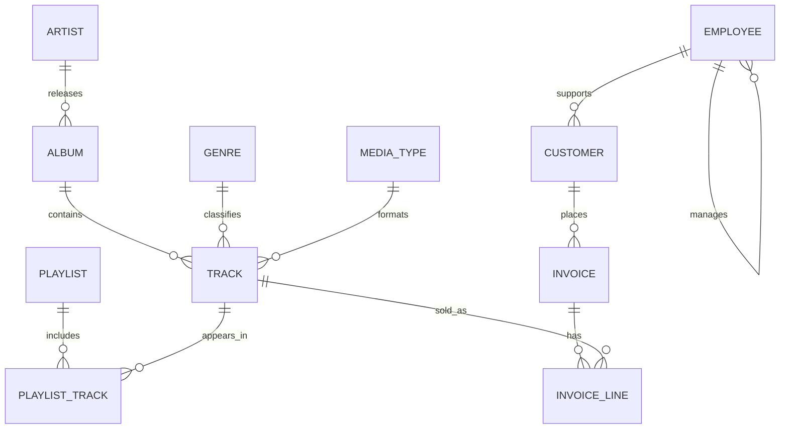

# 🎵 Music Store SQL Analysis
 
An end-to-end SQL portfolio project built on a digital music store database (the Chinook sample schema). It covers relational schema design, reproducible data loading, and **11 business questions** that progress from basic aggregation to CTEs and window functions, all written in PostgreSQL.
 
---
 
## Table of Contents
 
- [Project Highlights](#project-highlights)
- [Dataset Overview](#dataset-overview)
- [Repository Structure](#repository-structure)
- [Data Model](#data-model)
- [Getting Started](#getting-started)
- [Analysis Questions](#analysis-questions)
- [SQL Techniques Demonstrated](#sql-techniques-demonstrated)
- [Data Quality Notes](#data-quality-notes)
- [Corrections to the Original Queries](#corrections-to-the-original-queries)
- [Roadmap](#roadmap)
- [Author](#author)
---
 
## Project Highlights
 
- **Clean, runnable schema** with primary keys, foreign keys and indexes, replacing a raw dump that could not be executed as-is.
- **Reproducible pipeline**: create the database, load 11 CSV files and run every query with a handful of commands.
- **11 business questions** grouped into Easy, Moderate and Advanced tiers.
- **Tie-safe results**: advanced queries use `RANK()` or a max-per-group join so tied rows are never silently dropped.
- **Money-safe types**: monetary columns use `NUMERIC(10,2)` to avoid floating-point rounding errors.
- **Documented fixes** for every issue found in the original query file.
---
 
## Dataset Overview
 
The database models a digital music store: a catalog of artists, albums, tracks and genres, together with customers, employees, invoices and playlists.
 
| Table            |  Rows | Grain                                        |
| ---------------- | ----: | -------------------------------------------- |
| `artist`         |   275 | One row per artist                           |
| `album`          |   347 | One row per album                            |
| `genre`          |    25 | One row per music genre                      |
| `media_type`     |     5 | One row per media format                     |
| `track`          | 3,503 | One row per track                            |
| `playlist`       |    18 | One row per playlist                         |
| `playlist_track` | 8,715 | One row per track in a playlist (many-to-many) |
| `employee`       |     9 | One row per employee                         |
| `customer`       |    59 | One row per customer                         |
| `invoice`        |   614 | One row per invoice (one purchase)           |
| `invoice_line`   | 4,757 | One row per track on an invoice              |
 
> **Source files:** UTF-8 CSVs. `employee.birthdate` and `employee.hire_date` use `DD-MM-YYYY`; every other date column uses ISO `YYYY-MM-DD`.
 
---
 
## Repository Structure
 
```text
Music-Playlist-SQL-Project/
├── README.md
├── data/
│   ├── raw/
│   │   ├── Music_Store_database.sql             # original dump (reference only)
│   │   ├── Music_Store_Query.sql                # original analysis file (superseded)
│   │   ├── Music Store- Create Tables Query.txt # first-draft DDL (superseded)
│   │   └── *.csv                                # 11 source tables
│   └── processed/                               # cleaned data and exported results
├── sql/
│   ├── 01_create_tables.sql                     # runnable schema: keys, FKs, indexes
│   └── 02_analysis_queries.sql                  # the 11 analysis queries
```
 
> [!NOTE]
> `data/raw/Music_Store_database.sql` is the original dump and is **not intended to be executed directly**. It mixes `CREATE DATABASE` with table definitions, uses `billing_postal` where the CSV has `billing_postal_code`, and defines no foreign keys. Use `sql/01_create_tables.sql` instead.
>
> Likewise, `data/raw/Music_Store_Query.sql` has been superseded by the corrected and documented `sql/02_analysis_queries.sql`.
 
---
 
## Data Model
 

 
**Key relationships**
 
- `artist` 1 → * `album` 1 → * `track`
- `genre` 1 → * `track` and `media_type` 1 → * `track`
- `playlist` * ↔ * `track` through `playlist_track`
- `employee` 1 → * `customer` via `support_rep_id`; `employee.reports_to` is a self-reference to the manager
- `customer` 1 → * `invoice` 1 → * `invoice_line` * → 1 `track`
`employee.levels` (L1–L7) stores the seniority band. The ERD omits it, but the seniority question depends on it, so it is kept in the schema.
 
---
 
## Getting Started
 
### Prerequisites
 
- PostgreSQL 12 or newer
- `psql` available on your `PATH` (or use the full path to the binaries)
### 1. Create the database and schema
 
```bash
createdb -U postgres music_store
psql -U postgres -d music_store -f sql/01_create_tables.sql
```
 
> [!WARNING]
> The schema script drops and recreates all tables, so it is safe to re-run during development. **Do not run it against a database whose data you want to keep.**
 
### 2. Load the CSV data
 
Run from the project root so the relative paths resolve. Save the following as `load_data.sql` (or paste it into `psql`) and execute it:
 
```sql
\set ON_ERROR_STOP on
SET client_encoding = 'UTF8';
SET datestyle = 'DMY';          -- employee dates are DD-MM-YYYY
 
BEGIN;
\copy artist         (artist_id, name) FROM 'data/raw/artist.csv' WITH (FORMAT csv, HEADER true);
\copy album          (album_id, title, artist_id) FROM 'data/raw/album.csv' WITH (FORMAT csv, HEADER true);
\copy genre          (genre_id, name) FROM 'data/raw/genre.csv' WITH (FORMAT csv, HEADER true);
\copy media_type     (media_type_id, name) FROM 'data/raw/media_type.csv' WITH (FORMAT csv, HEADER true);
\copy track          (track_id, name, album_id, media_type_id, genre_id, composer, milliseconds, bytes, unit_price) FROM 'data/raw/track.csv' WITH (FORMAT csv, HEADER true);
\copy playlist       (playlist_id, name) FROM 'data/raw/playlist.csv' WITH (FORMAT csv, HEADER true);
\copy playlist_track (playlist_id, track_id) FROM 'data/raw/playlist_track.csv' WITH (FORMAT csv, HEADER true);
\copy employee       (employee_id, last_name, first_name, title, reports_to, levels, birthdate, hire_date, address, city, state, country, postal_code, phone, fax, email) FROM 'data/raw/employee.csv' WITH (FORMAT csv, HEADER true);
\copy customer       (customer_id, first_name, last_name, company, address, city, state, country, postal_code, phone, fax, email, support_rep_id) FROM 'data/raw/customer.csv' WITH (FORMAT csv, HEADER true);
\copy invoice        (invoice_id, customer_id, invoice_date, billing_address, billing_city, billing_state, billing_country, billing_postal_code, total) FROM 'data/raw/invoice.csv' WITH (FORMAT csv, HEADER true);
\copy invoice_line   (invoice_line_id, invoice_id, track_id, unit_price, quantity) FROM 'data/raw/invoice_line.csv' WITH (FORMAT csv, HEADER true);
COMMIT;
```
 
> [!IMPORTANT]
> Keep the `BEGIN` / `COMMIT` wrapper. `employee.reports_to` is a deferred foreign key because the first employee row reports to an employee that appears later in the file.
 
### 3. Run the analysis
 
```bash
psql -U postgres -d music_store -f sql/02_analysis_queries.sql
```
 
---
 
## Analysis Questions
 
### 🟢 Easy
 
| #   | Business Question                                          | Concepts                |
| --- | ---------------------------------------------------------- | ----------------------- |
| 1   | Who is the most senior employee by job title?              | `ORDER BY`, `LIMIT`     |
| 2   | Which countries have the most invoices?                    | `GROUP BY`, `COUNT`     |
| 3   | What are the top 3 invoice totals?                         | `ORDER BY`, `LIMIT`     |
| 4   | Which city has the best customers (highest invoice total)? | `SUM`, `GROUP BY`       |
| 5   | Who is the best customer by total spend?                   | `JOIN`, `SUM`, `GROUP BY` |
 
### 🟡 Moderate
 
| #   | Business Question                                     | Concepts                                 |
| --- | ----------------------------------------------------- | ---------------------------------------- |
| 1   | Who listens to Rock? (email, name, genre)             | Multi-table `JOIN`, `DISTINCT`, `EXISTS` |
| 2   | Which artists wrote the most Rock music? (top 10)     | Multi-table `JOIN`, `COUNT`              |
| 3   | Which tracks are longer than the average track?       | Scalar subquery, `AVG`                   |
 
### 🔴 Advanced
 
| #   | Business Question                                          | Concepts                              |
| --- | ---------------------------------------------------------- | ------------------------------------- |
| 1   | How much did each customer spend on the best-selling artist? | CTE, revenue calculation            |
| 2   | What is the most popular genre in each country?            | CTE + `RANK()` / max-per-group join   |
| 3   | Which customer spent the most in each country?             | CTE + `RANK()` / max-per-group join   |
 
Advanced questions 2 and 3 each have **two equivalent solutions**: a window-function version and a join-to-max version. Both return every row that ties for first place, as the questions require.
 
---
 
## SQL Techniques Demonstrated
 
| Category            | Techniques                                                              |
| ------------------- | ----------------------------------------------------------------------- |
| Aggregation         | `COUNT`, `SUM`, `AVG`, `GROUP BY`                                       |
| Joins               | Multi-table `INNER JOIN` across the catalog and sales hierarchy         |
| Subqueries          | Scalar subqueries, `EXISTS`                                             |
| CTEs                | Multi-step logic with readable, named intermediate results              |
| Window functions    | `RANK()` for tie-aware top-N per group                                  |
| Schema design       | Primary and foreign keys, deferred constraints, indexes, `NUMERIC` money |
| Data loading        | `psql` `\copy`, transactional loads, `datestyle` handling               |
 
---
 
## Data Quality Notes
 
- All foreign keys in the CSVs are valid; no orphan rows were found.
- `invoice_line.quantity` is always `1`, so `SUM(quantity)` and `COUNT(*)` produce the same popularity ranking.
- `playlist_track` contains no duplicate `(playlist_id, track_id)` pairs, so the composite primary key holds.
- `invoice.total` is stored as `NUMERIC(10,2)` to avoid floating-point rounding when summing money.
---
 
## Corrections to the Original Queries
 
The following issues were found in the original query file and fixed in `sql/02_analysis_queries.sql`:
 
| Issue                                                    | Fix                                                            |
| -------------------------------------------------------- | -------------------------------------------------------------- |
| Table referenced as `invoiceline`                        | Corrected to `invoice_line`                                    |
| Column misspelled as `miliseconds`                       | Corrected to `milliseconds`                                    |
| "Top 3 invoice totals" query had no row limit            | Added `LIMIT 3`                                                |
| `ROW_NUMBER()` silently dropped tied rows                | Replaced with `RANK()` or a max-per-group join                 |
| Non-aggregated columns relied on implicit functional dependency | All non-aggregated `SELECT` columns are listed in `GROUP BY` |
 
---
 
## Roadmap
 
- [ ] Add revenue-by-month and year-over-year growth queries
- [ ] Export result sets to `data/processed/`
- [ ] Add a `make` / PowerShell script that creates the database, loads the data and runs the queries in one step
---
 
## Author
 
**Md Idris (Shawon)** — Junior Data Analyst
 
- Portfolio: [shawon-analyst-portfolio.vercel.app](https://shawon-analyst-portfolio.vercel.app)
- GitHub: [@shawon-analyst](https://github.com/shawon-analyst)
- LinkedIn: [shawonanalyst](https://www.linkedin.com/in/shawonanalyst)
If you found this project useful, consider giving it a ⭐.
 